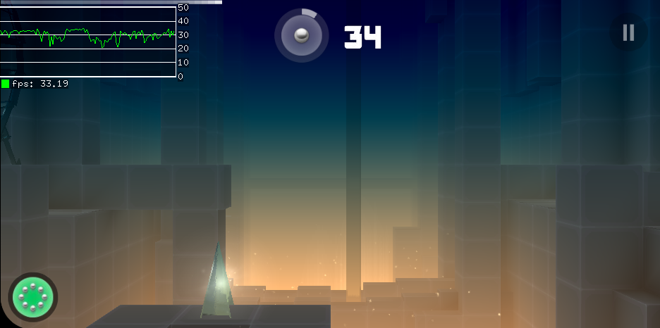

# Running Apps

The following apps have been tested with ATL. The table below lists the apps, their package name, version, any environment variables that need to be set, whether they phone home, whether they need an internet connection, and any other notes.

| id | name | version | override envs needed | phones home? | needs internet connection? | notes | screenshot                                                       |
|----|------|---------|----------------------|----------------------------------|--------------------------------------------------------------------|-------|------------------------------------------------------------------|
| com.mediocre.smashhit | SmashHit | 1.4.3 | SLES_SDL_FREQ=44100 LINKER_DIE_AT_RUNTIME= | not in an obvious way | no (candidate for `unshare -n`, see below) | [libSLES](https://gitlab.com/Mis012/libopensles-standalone/) needed; version 1.4.3 has aarch64 natives, 1.4.2 has x86 (32bit) natives; crashes if /proc/cpuinfo is larger than 4096 bytes (mount --bind is your friend); premium version is an in-app purchase, so cannot be obtained; UPDATE: newer versions are now available, which also include x86_64 natives; they however seem to also include ads and general bloat |  |
| com.zeptolab.ctror.subscr.tier | Cut The Rope | 3.15.1 | none (LINKER_DIE_AT_RUNTIME= on aarch64) | probably | no (candidate for `unshare -n`, see below) | assets being read from filesystem allows easy level editing | |
| com.zeptolab.ctr2.paid.google | Cut The Rope 2 | 1.17.2 | none (LINKER_DIE_AT_RUNTIME= on aarch64) | definitely, forces you to agree which violates GDPR | no (candidate for `unshare -n`, see below) | needs a hack to noop currently broken complex youtube thumbnail mess; see hacks/README.md for how to apply it; to make the game playable without supporting abominable business practices, set ENERGY_REFUEL_SPEED in shared prefs xml to e.g 30000 |  |
| com.ustwo.monumentvalley | Monument Valley | 2.7.16 | LINKER_DIE_AT_RUNTIME= | definitely, uses Facebook SDK | no (candidate for `unshare -n`, see below) | `</dev/null` needed for some reason (android does this for all apps); Google Play License Verification needs to be manually patched out from the il2cpp.so (it seems like a massive PITA to implement properly); serves as an example of a Unity app - other Unity apps should also work with minimal effort |  |
| com.dotgears.flappybird | Flappy Bird | 1.3 | none | seems not | no (candidate for `unshare -n`, see below) | doesn't use native code |  |
| com.rovio.angrybirds | Angry Birds | 3.2.0/3.3.2 | none | yes | no (candidate for `unshare -n`, see below) | version 3.2.0/3.3.2 only has 32bit shared libraries; the app doesn't launch properly if window height is larger than window width |  |
| com.htc.android.teeter | Teeter | 1.0.2114352037.51978 | none | nothing obvious in decompiled code | no | doesn't use native code; uses acelerometer; (this version) doesn't like non-540p window size, ATL_DISABLE_WINDOW_DECORATIONS and (if your device is 540p) ATL_FORCE_FULLSCREEN can help |  |
| com.kiloo.subwaysurf | Subway Surfers | 1.45 | LINKER_DIE_AT_RUNTIME= | certainly | no (candidate for `unshare -n`, see below) | no 86_64 natives, can use x86 ones if you have multilib |  |
